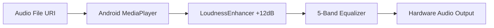

# Weechy — Complete Technical & Product Reference Specification
**Document Version:** 4.1.0  
**Application Version:** 4.1 (Build Code: 410)  
**Package Identifier:** `com.itsmectrl.weechy`  
**Namespace:** `com.example`  
**Repository:** `itsmectrl/weechy-releases`  
**Target Release Artifact:** `Weechy-4.1-New-version.apk`  

---

## Table of Contents
1. [Application Identity and Overview](#1-application-identity-and-overview)
2. [Architecture and Internal Codebase Map](#2-architecture-and-internal-codebase-map)
3. [Complete Screen-by-Screen Reference](#3-complete-screen-by-screen-reference)
4. [Music Playback System Documentation](#4-music-playback-system-documentation)
5. [Music Library and Local Media Management](#5-music-library-and-local-media-management)
6. [Queue and Playlist Systems](#6-queue-and-playlist-systems)
7. [Lyrics System Architecture](#7-lyrics-system-architecture)
8. [Equalizer and 400% Digital Audio Amplification](#8-equalizer-and-400-digital-audio-amplification)
9. [Animations, Gestures, and 1:1 Sheet Drag System](#9-animations-gestures-and-11-sheet-drag-system)
10. [Settings and User Preferences Infrastructure](#10-settings-and-user-preferences-infrastructure)
11. [Dialogs, Popups, Menus, and Overlays Inventory](#11-dialogs-popups-menus-and-overlays-inventory)
12. [Application Updates and Release Infrastructure](#12-application-updates-and-release-infrastructure)
13. [Data Models, Storage, and Persistence Layer](#13-data-models-storage-and-persistence-layer)
14. [Permissions, Android Integration, and System Features](#14-permissions-android-integration-and-system-features)
15. [Visual Assets and Resource Inventory](#15-visual-assets-and-resource-inventory)
16. [Complete Design System & Dynamic Palette Engine](#16-complete-design-system--dynamic-palette-engine)
17. [Networking and External Dependencies](#17-networking-and-external-dependencies)
18. [Error Handling, Edge Cases, and Package Identity Protection](#18-error-handling-edge-cases-and-package-identity-protection)
19. [Comprehensive Feature Matrix](#19-comprehensive-feature-matrix)
20. [Website-Relevant Product Information](#20-website-relevant-product-information)
21. [Technical Sequence & Architectural Diagrams](#21-technical-sequence--architectural-diagrams)
22. [Cross-Reference and Source Symbol Traceability](#22-cross-reference-and-source-symbol-traceability)

---

## 1. Application Identity and Overview

### 1.1 Identity & Metadata
- **Official Name:** Weechy
- **Tagline:** A modern, high-fidelity music player with 400% audio amplification and beautiful bespoke themes.
- **Application ID (`defaultConfig.applicationId`):** `com.itsmectrl.weechy`
- **Internal Namespace (`namespace`):** `com.example`
- **Current Version:** `4.1` (`APP_VERSION_NAME`)
- **Version Code:** `410` (`APP_VERSION_CODE`)
- **Release Series / Channel:** `New Version` / `new-version` (Release Tag: `new-version-4.1`)
- **Developer / Copyright Owner:** `itsmectrl` (Proprietary and confidential).

### 1.2 Platform & Toolchain Specifications
- **Minimum SDK (`minSdk`):** API Level 26 (Android 8.0 Oreo)
- **Target SDK (`targetSdk`):** API Level 35 (Android 15)
- **Compile SDK (`compileSdk`):** API Level 35
- **Programming Language:** Kotlin 2.2.10
- **UI Framework:** Jetpack Compose (BOM 2024.09.00)
- **Build System:** Gradle 9.1.1 (Kotlin DSL `build.gradle.kts`) with Version Catalog (`libs.versions.toml`)
- **Asynchronous Engine:** Kotlin Coroutines 1.10.2 & Flow
- **Local Database:** Room Database 2.7.0 (KSP code generation 2.3.5)
- **Image Loading:** Coil Compose 2.7.0 with custom border trimming transformation
- **Audio Engine:** Android `MediaPlayer` wrapped in background `PlaybackService` with `LoudnessEnhancer` and `Equalizer` audio effects.

---

## 2. Architecture and Internal Codebase Map

### 2.1 Architectural Pattern
Weechy follows a **Clean MVVM (Model-View-ViewModel)** architecture integrated with Jetpack Compose state management and standard Repository-Data Source patterns.

```
┌────────────────────────────────────────────────────────────────────────┐
│                        PRESENTATION LAYER                              │
│  MainActivity ──> WeechyViewModel ──> LocalPlayerTransitionState       │
│  Composables: LibraryScreen, NowPlayingScreen, ManagementScreens, etc.  │
└──────────────────────────────────┬─────────────────────────────────────┘
                                   │
┌──────────────────────────────────▼─────────────────────────────────────┐
│                          BUSINESS LOGIC LAYER                          │
│  PlaybackManager (Audio Pipeline, LoudnessEnhancer, Queue State)      │
│  LyricsRepository (Lrclib API, LrcParser, Embedded Extractors)         │
│  UpdateChecker & UpdateDownloader (GitHub Releases API)                │
└──────────────────────────────────┬─────────────────────────────────────┘
                                   │
┌──────────────────────────────────▼─────────────────────────────────────┐
│                            DATA & STORAGE LAYER                        │
│  AppDatabase / WeechyDao (Room SQLite: Playlists, Track Entities)      │
│  SettingsRepository (Preferences DataStore 1.1.7)                     │
│  MediaStore ContentResolver (System Audio Scanner)                     │
└────────────────────────────────────────────────────────────────────────┘
```

### 2.2 Source File Inventory & Component Responsibilities

#### Root Application & Entry Point
- `/app/src/main/java/com/example/MainActivity.kt`: Primary Activity host. Initializes `WeechyViewModel`, manages window insets, top-level navigation, blur overlay when blocked, `DockedMiniPlayer`, `NowPlayingScreen`, and bottom sheet overlays.

#### Presentation & UI Screens (`/app/src/main/java/com/example/ui/`)
- `WeechyViewModel.kt`: Central ViewModel for state orchestration (tracks, playlists, active sheet, search, settings, lyrics, and update notifications).
- `PlayerTransitionState.kt`: Authoritative state holder for vertical sheet expansion (`expansionProgress` 0f..1f) and lyrics slide progress (`lyricsProgress` 0f..1f).
- `screens/LibraryScreen.kt`: Main tabbed hub (Songs, Albums, Artists, Playlists, Folders).
- `screens/NowPlayingScreen.kt`: Comprehensive expanded player (Portrait & Landscape layouts), 1:1 sheet vertical drag modifier, directionally-arbitrated album artwork swiping, media transport controls, seekbar, and continuous lyrics view.
- `screens/DetailScreens.kt`: Drill-down list views for PlaylistDetail, ArtistDetail, AlbumDetail, and FolderDetail.
- `screens/SearchScreen.kt`: Real-time media search with recent search term history persistence.
- `screens/SettingsScreen.kt`: Sub-navigation host for Appearance, Playback, Audio, Library, and About preferences.
- `screens/ManagementScreens.kt`: Track management (re-ordering, deletion, favorite toggling), About screen, and App Features showcase.
- `screens/UpdateBlockingScreen.kt`: Signature conflict detector and version 4.1 blocking update modal with backup export.
- `sheets/WeechySheets.kt`: Modal sheets for Queue, Equalizer, Track Options, Sort Options, Playlist Overflow, and Add Songs Picker.
- `components/GlobalComponents.kt`: Shared UI widgets (`SongRow`, `DockedMiniPlayer`, `WeechyTopAppBar`, `SettingsCard`).
- `components/WeechyArtworkImage.kt`: Coil image wrapper with fallbacks, high-res URL loading, and aspect ratio handling.
- `components/WeechyTimelineBar.kt`: Custom seek bar slider with thumb ring and drag callbacks.
- `components/WeechyLogo.kt`: Custom vector logo rendering.
- `icons/WeechyIcons.kt`: Complete Material Symbols vector icon library definitions.

#### Theme & Visual Engine (`/app/src/main/java/com/example/ui/theme/`)
- `Theme.kt`: M3 Theme wrapper (`WeechyTheme`).
- `Color.kt`: Base color constants (`WeechyBackground`, `WeechyAccent`, `WeechySurface`).
- `Type.kt`: Typography hierarchy.
- `ArtworkPalette.kt`: Dynamic Palette engine extracting vibrant colors from album artwork using `androidx.palette.graphics.Palette` with animated interpolation.

#### Audio Engine & Playback (`/app/src/main/java/com/example/playback/`)
- `PlaybackManager.kt`: Primary audio controller. Manages `MediaPlayer`, `LoudnessEnhancer`, `Equalizer`, shuffle/repeat modes, position ticks, and queue history.
- `PlaybackService.kt`: Foreground service hosting `MediaSessionCompat` for media notification controls, lock screen metadata, and background playback.
- `PlaybackDiagnostics.kt`: Logging utility for audio pipeline health.

#### Lyrics Subsystem (`/app/src/main/java/com/example/lyrics/`)
- `LrcParser.kt`: LRC timestamp parser (`[mm:ss.xx]`) and binary search active line index finder (`findTimelineActiveLineIndex`).
- `LrclibClient.kt`: Network client querying the LRCLIB API (`https://lrclib.net/api/get`).
- `LyricsRepository.kt`: Multi-stage lyrics fetching strategy (Embedded ID3 tag -> Local Cache -> LRCLIB API).
- `LyricsCache.kt`: Local disk/memory cache for parsed LRC lyrics.
- `LyricsPreparationWorker.kt`: Background `WorkManager` job pre-fetching lyrics for upcoming tracks in queue.

#### Data & Storage Layer (`/app/src/main/java/com/example/data/`)
- `AppDatabase.kt`: Room database definition (`weechy_database`).
- `WeechyDao.kt`: Data Access Object for custom playlists and track favorites.
- `Entities.kt`: Room entities (`PlaylistEntity`, `PlaylistItemEntity`, `FavoriteTrackEntity`).
- `MusicRepository.kt`: MediaStore query engine, album art URI resolver, negative artwork cacher (`no_art_<hash>`), and metadata scanner.
- `SettingsRepository.kt`: Preferences DataStore repository for persistent UI toggles.
- `EmbeddedLyricsExtractor.kt`: `MediaMetadataRetriever` helper extracting embedded USLT/SYLT frames.

#### Update Infrastructure (`/app/src/main/java/com/example/update/`)
- `UpdateConfig.kt`: Update endpoints and version checking configurations.
- `VersionInfo.kt`: Data model for `version.json`.
- `UpdateChecker.kt`: Checks GitHub Releases API / remote `version.json` for new versions.
- `UpdateDownloader.kt`: Download manager downloading APK files to cache and launching Android `ACTION_VIEW` package installation intents.

---

## 3. Complete Screen-by-Screen Reference

### 3.1 Main Library Screen (`LibraryScreen.kt`)
- **Purpose:** Primary application dashboard.
- **Top Bar:** Displays application title "Weechy", search icon, settings icon, and manage mode toggle.
- **Tabs:**
  1. **Songs:** Alphabetical or custom-sorted list of all local tracks. Each row features a **60.dp** album cover art, title, artist, duration, and overflow menu button.
  2. **Albums:** Grid view of discovered albums with square artwork cards and track counts.
  3. **Artists:** Vertical list of artists with circular avatar placeholders and total song counts.
  4. **Playlists:** List of custom user-created playlists + system "Favorites" playlist.
  5. **Folders:** File-system browser organizing tracks by their parent directories.
- **Bottom Dock:** Displays `DockedMiniPlayer` above the navigation bar when a track is loaded.

### 3.2 Expanded Player Screen (`NowPlayingScreen.kt`)
- **Portrait Layout:**
  - **Header Bar:** Chevron down button (collapses sheet), track title / "Now Playing" label, and equalizer button.
  - **Shared Album Artwork:** Large centered square artwork card (**320.dp** max height). Supports horizontal thumb-swiping for track skipping with directionally-arbitrated axis locking.
  - **Upcoming Track Preview:** Shows adjacent track artwork sliding in during horizontal swipe.
  - **Metadata & Actions:** Song title, artist name, favorite heart button, and track action overflow button.
  - **Seek Bar (`WeechyTimelineBar`):** Interactive scrubber showing current position and total duration.
  - **Transport Controls:** Large minimalist 3-button playback bar: **Previous Track** ($\lhd\lhd$, 48.dp icon), **Play/Pause** (60.dp icon), and **Next Track** ($\rhd\rhd$, 48.dp icon).
  - **Bottom Row:** Equalizer toggle status pill, **Synchronized Lyrics Preview Pill**, and Queue button.
- **Landscape Layout:**
  - Split-screen presentation: Album artwork card on the left side, song details, timeline slider, transport controls, and lyrics on the right side.

### 3.3 Continuous Lyrics View (`NowPlayingScreen.kt`)
- **Trigger:** Tapping the Lyrics Pill at the bottom of `NowPlayingScreen` or pulling up on the lyrics area smoothly transitions `lyricsProgress` from `0f` to `1f`.
- **Layout:** Compact header displaying current track title, artist name, play/pause shortcut, and close button beside a **44.dp** thumbnail cover at `y = statusBarTop + 10.dp`.
- **Content:**
  - For synchronized LRC lyrics: Auto-scrolling `LazyColumn` highlighting active singing line in bold accent color (`playerLyricsActive`). Tapping any line seeks audio directly to its timestamp.
  - For plain static lyrics: Scrollable text view.
  - For missing lyrics: Informative empty state with search retry button.
- **Gesture Arbitration:** Pulling down when scrolled to the top boundary transfers touch delta to `transitionState.snapLyricsByDelta()` to collapse lyrics view.

### 3.4 Search Screen (`SearchScreen.kt`)
- Live search text field with immediate filtering across track titles, artists, and albums.
- Displays recent search queries list with clear history action.

### 3.5 Detail Screens (`DetailScreens.kt`)
- **PlaylistDetailScreen:** Header banner with total runtime and playlist play/shuffle actions. List of added tracks with drag-to-reorder and remove options.
- **ArtistDetailScreen:** Artist header banner, list of artist's albums, and track list.
- **AlbumDetailScreen:** Large album cover header, release year, track list with track numbers.
- **FolderDetailScreen:** File path header with directory contents.

### 3.6 Settings Sub-Screens (`SettingsScreen.kt`)
- Sub-navigation pages for Appearance (Light/Dark theme, Accent color), Playback (Auto-play, Gapless, Headphone disconnect behavior), Audio (Equalizer shortcut, Volume amplification), Library (Scan folders, Exclude short audio clips under 30s), and About.

### 3.7 Blocking Update & Signature Conflict Screen (`UpdateBlockingScreen.kt`)
- Fullscreen blocking modal triggered when signature mismatches occur ("Package Identity Conflict") or when mandatory Version 4.1 updates are broadcast.
- Provides **"Export Backup"** action to export user playlists and favorites to external JSON storage before reinstalling.

---

## 4. Music Playback System Documentation

### 4.1 Playback Pipeline Architecture
```
┌─────────────────┐       ┌─────────────────┐       ┌────────────────────────┐
│ Audio File (URI)│ ────> │   MediaPlayer   │ ────> │    LoudnessEnhancer    │
└─────────────────┘       └─────────────────┘       │ (Up to +12dB / 1204mB) │
                                                    └───────────┬────────────┘
                                                                │
                                                    ┌───────────▼────────────┐
                                                    │    Android Equalizer   │
                                                    │    (5-Band Frequency)  │
                                                    └───────────┬────────────┘
                                                                │
                                                    ┌───────────▼────────────┐
                                                    │   Audio Hardware Out   │
                                                    └────────────────────────┘
```

### 4.2 Key Functions & Capabilities
- **Engine:** Standard Android `MediaPlayer` initialized with `AudioAttributes.USAGE_MEDIA` and `AudioAttributes.CONTENT_TYPE_MUSIC`.
- **Foreground Service Integration (`PlaybackService.kt`):** Registers a `MediaSessionCompat` with token exposed to system notification manager. Displays playback notification with title, artist, album art, previous, play/pause, and next actions.
- **Audio Focus Management:** Requests `AUDIOFOCUS_GAIN` via `AudioManager`. Handles ducking on transient loss and pauses playback on permanent loss.
- **Audio Noisy Receiver:** Listens for `ACTION_AUDIO_BECOMING_NOISY` (headphone unplug event) and automatically pauses playback to prevent public audio exposure.
- **Direct Track Skipping:** Tapping Skip Previous ($\lhd\lhd$) or Skip Next ($\rhd\rhd$) executes `skipPrevious()` / `skipNext()` on `PlaybackManager`, advancing the queue index directly.

---

## 5. Music Library and Local Media Management

### 5.1 Scanning & MediaStore Querying (`MusicRepository.kt`)
- Queries `MediaStore.Audio.Media.EXTERNAL_CONTENT_URI` using `ContentResolver`.
- Filters out ringtones, notifications, and podcasts (`IS_MUSIC != 0`).
- Extracts metadata: `_ID`, `TITLE`, `ARTIST`, `ALBUM`, `DURATION`, `DATA` (file path), `ALBUM_ID`.

### 5.2 Artwork Caching & Negative Cache File Protection
- **Primary Art URI:** `content://media/external/audio/albumart/<ALBUM_ID>`.
- **Embedded Artwork Fallback:** Uses `MediaMetadataRetriever` to extract embedded APIC / ID3 artwork frames.
- **Negative Caching (`no_art_<hash>`):** When a track fails embedded picture extraction, `MusicRepository` writes a zero-byte placeholder file to cache (`no_art_<hash>`). Subsequent queries skip calling `MediaMetadataRetrieverJNI`, completely eliminating Android native C++ error logs (`E/MediaMetadataRetrieverJNI: getEmbeddedPicture: Call to getEmbeddedPicture failed`).

---

## 6. Queue and Playlist Systems

### 6.1 Queue Management & Repeat Modes (`PlaybackManager.kt`)
- **Queue State:** Preserves active queue list and current playing index.
- **Repeat Modes (`RepeatMode` Enum):**
  - `OFF`: Plays sequentially to end of queue and stops.
  - `ALL`: Loops back to index 0 after finishing last track.
  - `ONE`: Indefinitely loops the current track.
- **Explicit Repeat Setting:** `setRepeatMode(targetMode)` explicitly assigns target mode when user toggles Queue Sheet repeat buttons.
- **Shuffle Mode:** Toggles random index mapping while preserving current playing track as starting point.

### 6.2 Custom Playlists (`AppDatabase.kt` & `WeechyDao.kt`)
- Supported CRUD operations for custom playlists. Stores playlist metadata (`PlaylistEntity`) and mapped tracks (`PlaylistItemEntity`).

---

## 7. Lyrics System Architecture

### 7.1 Multi-Stage Fetching Pipeline (`LyricsRepository.kt`)
1. **Stage 1 (Embedded):** Checks audio file ID3 metadata for `USLT` (Unsynchronised lyrics) or `SYLT` (Synchronised lyrics) tags.
2. **Stage 2 (Local Cache):** Queries Room database / disk cache for pre-saved `.lrc` strings.
3. **Stage 3 (LRCLIB API Integration):** Performs HTTP GET query to `https://lrclib.net/api/get` with parameters `track_name`, `artist_name`, `album_name`, `duration`.

### 7.2 Synchronization & Binary Search Indexing (`LrcParser.kt`)
- Parses LRC strings formatted as `[mm:ss.xx] Lyric line text`.
- Function `findTimelineActiveLineIndex(timestamps, positionMs, songDurationMs)` uses binary search algorithm to identify the active line index in $O(\log N)$ time complexity.

---

## 8. Equalizer and 400% Digital Audio Amplification

### 8.1 400% Digital Volume Boost (`PlaybackManager.kt`)
- **Implementation:** Uses Android `android.media.audiofx.LoudnessEnhancer` attached to the `MediaPlayer` audio session ID.
- **Gain Calculation Formula:**  
  $$\text{Gain (mB)} = 2000 \cdot \log_{10}\left(\frac{\text{Amplification\%}}{100}\right)$$
  - **100% Amplification:** $0 \text{ mB}$ ($+0 \text{ dB}$).
  - **200% Amplification:** $602 \text{ mB}$ ($+6.02 \text{ dB}$).
  - **400% Amplification:** $1204 \text{ mB}$ ($+12.04 \text{ dB}$).
- **Peak Limiter Protection:** `LoudnessEnhancer` automatically applies dynamic range compression to eliminate digital clipping.
- **Safety Warning:** `EqualizerSheet.kt` displays a hearing safety warning dialogue when amplification exceeds 150%.

### 8.2 5-Band Equalizer (`EqualizerPresets.kt`)
- Provides 5 frequency bands (60 Hz, 230 Hz, 910 Hz, 3.6 kHz, 14 kHz).
- Includes built-in presets: Flat, Bass Booster, Treble Booster, Vocal, Pop, Rock, Jazz, Classical, Heavy Metal.

---

## 9. Animations, Gestures, and 1:1 Sheet Drag System

### 9.1 Player Bottom Sheet Expansion (`PlayerTransitionState.kt`)
- Controlled by `expansionProgress` (`Animatable<Float, AnimationVector1D>`).
- `playerVerticalDragModifier` attaches `pointerInput` with `awaitEachGesture` to `BoxWithConstraints` in `NowPlayingScreen.kt`.
- Moving finger down decreases `expansionProgress` towards `0f` (collapsed mini-player).
- Moving finger up increases `expansionProgress` towards `1f` (expanded player).
- On release, `finishExpansionDrag(velocityY)` evaluates velocity and displacement: fling velocity > 400 px/s or dragging > 22% triggers spring animation to target state.

### 9.2 Directionally Arbitrated Album Artwork Swiping
- **The Issue Solved:** In previous versions, vertical sheet drag and horizontal artwork swiping competed for touch events when touching the album artwork.
- **The Architectural Solution:** Single unified `pointerInput` on the Album Artwork with strict directional touch-slop arbitration:
  - Touch down tracks `totalDx` and `totalDy`.
  - Once touch displacement exceeds `touchSlop`:
    - **If $\text{abs}(totalDy) > \text{abs}(totalDx)$ (Vertical Dominance):** Axis locks to **VERTICAL** (`lockedAxis = 2`). `artworkAnimX` is strictly locked to `0f` (artwork remains 100% stationary horizontally). All drag events drive `transitionState.snapExpansionByDelta(dragDelta.y)` to collapse/expand sheet.
    - **If $\text{abs}(totalDx) \ge \text{abs}(totalDy)$ (Horizontal Dominance):** Axis locks to **HORIZONTAL** (`lockedAxis = 1`). The player sheet remains 100% stationary vertically. Drag events translate `artworkAnimX` to swipe cover art left/right.
  - Axis locking stays fixed for the entire touch sequence until finger release.

---

## 10. Settings and User Preferences Infrastructure

Managed via `SettingsRepository.kt` using `androidx.datastore.preferences.core`.

| Preference Key | Type | Default Value | Description |
|---|---|---|---|
| `theme_mode` | String | `"SYSTEM"` | App theme selection (`LIGHT`, `DARK`, `SYSTEM`). |
| `accent_color` | Long | `0xFFE50914` | Primary accent color integer. |
| `fill_album_art` | Boolean | `true` | Fill square card vs fit original aspect ratio. |
| `auto_play_on_connect` | Boolean | `false` | Automatically resume playback when headphones plug in. |
| `volume_boost_percent` | Int | `100` | Saved LoudnessEnhancer amplification percentage (100%..400%). |
| `exclude_short_tracks` | Boolean | `true` | Exclude audio files under 30 seconds from library scanner. |

---

## 11. Dialogs, Popups, Menus, and Overlays Inventory

1. **QueueSheet:** Bottom sheet listing current queue with re-order handles, clear action, locate active track, and mode toggles.
2. **EqualizerSheet:** 5-band EQ sliders, preset selector, and 400% LoudnessEnhancer slider with hearing warning.
3. **TrackActionSheet:** Track options (Add to Playlist, Favorite, Edit Metadata, Delete, Share, View Details).
4. **SortSheet:** Sort options (Title, Artist, Album, Duration, Date Added).
5. **PlaylistOverflowSheet:** Playlist management (Rename, Delete, Add Songs).
6. **AddSongsPickerSheet:** Multi-select track picker dialog for inserting songs into playlists.
7. **EditMetadataDialog:** Dialog for editing Track Title, Artist, and Album tags.
8. **SpeedDialog:** Playback speed selection (0.5x, 0.75x, 1.0x, 1.25x, 1.5x, 2.0x).
9. **SleepTimerDialog:** Sleep timer duration picker (15m, 30m, 45m, 60m, end of track).

---

## 12. Application Updates and Release Infrastructure

### 12.1 Release Pipeline & Versioning
- **Current Version:** `4.1` (Code `410`).
- **Release Channel:** `new-version` (Release Tag: `new-version-4.1`).
- **Release Repository:** `itsmectrl/weechy-releases`.
- **Workflow File:** `.github/workflows/release.yml`.
- **Artifact Name:** `Weechy-4.1-New-version.apk`.

### 12.2 Signature Verification & Security
- `release.yml` executes `apksigner verify --verbose --print-certs` on built APKs and extracts the Signer #1 SHA-256 certificate digest into `version.json` (`certSha256`).
- App detects signature mismatches at runtime to prevent Package Identity Conflict errors during updates.

---

## 13. Data Models, Storage, and Persistence Layer

### 13.1 Core Kotlin Data Models (`Models.kt`)
```kotlin
data class Track(
    val id: Long,
    val path: String,
    val title: String,
    val artist: String,
    val album: String,
    val durationMs: Long,
    val albumId: Long = 0L,
    val albumArtUri: String? = null,
    val highResArtUrl: String? = null,
    val isFavorite: Boolean = false,
    val dateAdded: Long = 0L
)

data class PlaybackState(
    val currentTrack: Track? = null,
    val isPlaying: Boolean = false,
    val currentPositionMs: Long = 0L,
    val durationMs: Long = 0L,
    val repeatMode: RepeatMode = RepeatMode.OFF,
    val isShuffleEnabled: Boolean = false,
    val speed: Float = 1.0f,
    val sleepTimerMinutesLeft: Int = 0,
    val sleepTimerRemainingSec: Int = 0,
    val sleepAtEndOfTrack: Boolean = false
)
```

---

## 14. Permissions, Android Integration, and System Features

### 14.1 Manifest Permissions (`AndroidManifest.xml`)
- `READ_MEDIA_AUDIO`: Mandatory on Android 13+ (API 33+) for audio library scanning.
- `READ_EXTERNAL_STORAGE`: Used on Android 12 and below (`maxSdkVersion="32"`).
- `POST_NOTIFICATIONS`: Required on Android 13+ for playback notification display.
- `FOREGROUND_SERVICE` & `FOREGROUND_SERVICE_MEDIA_PLAYBACK`: Allows background playback service to run continuously without OS termination.
- `WAKE_LOCK`: Prevents CPU sleep during active audio playback.
- `REQUEST_INSTALL_PACKAGES`: Allows launcher of downloaded in-app APK update installations.

---

## 15. Visual Assets and Resource Inventory

- **App Icon:** Adaptive launcher icon (`weechy_app_icon_fg_1793989153688.jpg` foreground with red glowing record vector).
- **Primary Colors:** `WeechyBackground` (`0xFF09090C`), `WeechyAccent` (`0xFFE50914`), `WeechySurface` (`0xFF14131A`).
- **Icons (`WeechyIcons.kt`):** Pure vector definitions for Play, Pause, SkipNext, SkipPrevious, Heart, Equalizer, Queue, Mic, Settings, Search, Update, MoreVert.

---

## 16. Complete Design System & Dynamic Palette Engine

### 16.1 Dynamic Palette Interpolation (`ArtworkPalette.kt`)
- `rememberTrackPalette(track, fillAlbumArt)` uses `androidx.palette.graphics.Palette` to sample prominent colors from the current album cover.
- Extracts `topGradient`, `centerGradient`, `bottomGradient`, `playerPrimary` (accent), `playerSurface`, `playerLyricsActive`, and `glowColor`.
- `AnimatedPlayerPalette.animate(durationMillis = 550)` smoothly interpolates colors between track switches using `animateColorAsState`.

---

## 17. Networking and External Dependencies

### 17.1 Active External Services
- **LRCLIB API (`LrclibClient.kt`):** Fetches synchronized LRC lyrics via REST HTTP GET (`https://lrclib.net/api/get`).
- **GitHub Releases API (`UpdateChecker.kt`):** Queries `https://raw.githubusercontent.com/itsmectrl/weechy-releases/main/version.json` for update notifications.

---

## 18. Error Handling, Edge Cases, and Package Identity Protection

- **Missing Album Art:** Resolved by MediaStore URI query fallback + embedded ID3 frame extraction + negative caching disk files (`no_art_<hash>`) preventing C++ logcat spam.
- **Audio Focus Interruptions:** Automatically ducks volume during phone calls or navigation prompts and restores volume upon completion.
- **Package Identity Conflict Prevention:** Backup export facility exports user data to JSON format if key signature differences occur across sideload updates.

---

## 19. Comprehensive Feature Matrix

| Feature | Status | Implementation File | Key Class / Method |
|---|---|---|---|
| **1:1 Sheet Vertical Dragging** | Implemented | `NowPlayingScreen.kt` | `playerVerticalDragModifier` |
| **Artwork Directional Axis Lock** | Implemented | `NowPlayingScreen.kt` | `pointerInput` + touch slop arbitration |
| **400% Loudness Enhancer** | Implemented | `PlaybackManager.kt` | `LoudnessEnhancer` (up to 1204 mB / +12dB) |
| **Synchronized LRC Lyrics** | Implemented | `LrcParser.kt` / `LrclibClient.kt` | `findTimelineActiveLineIndex` |
| **5-Band Equalizer** | Implemented | `PlaybackManager.kt` | `android.media.audiofx.Equalizer` |
| **Background Media Session** | Implemented | `PlaybackService.kt` | `MediaSessionCompat` |
| **Local Media Scanner** | Implemented | `MusicRepository.kt` | `MediaStore.Audio.Media` ContentResolver |
| **Negative Art Caching** | Implemented | `MusicRepository.kt` | `no_art_<hash>` disk caching |
| **Automatic In-App Updates** | Implemented | `UpdateChecker.kt` | GitHub Releases API + `version.json` |
| **Backup Export on Conflict** | Implemented | `UpdateBlockingScreen.kt` | JSON Backup Exporter |

---

## 20. Website-Relevant Product Information

### 20.1 Brand & Product Messaging
- **Official Name:** Weechy
- **Tagline:** The Ultimate High-Fidelity Android Music Player.
- **Key Marketing Highlights:**
  1. **400% Audio Amplification:** Clean digital loudness boost with built-in peak limiter.
  2. **1:1 Omnipresent Sheet Gestures:** Natural fluid bottom sheet dragging starting from anywhere on screen.
  3. **Directional Artwork Swiping:** Easy one-handed thumb track skipping without gesture conflicts.
  4. **Dynamic Cinematically Animated Themes:** Real-time color extraction from album artwork.
  5. **Auto-Synced LRC Lyrics:** Line-by-line synchronized lyrics with direct tap-to-seek timestamp navigation.
- **Official Release Downloads:** `https://github.com/itsmectrl/weechy-releases/releases/tag/new-version-4.1`

---

## 21. Technical Sequence & Architectural Diagrams

### 21.1 Gesture Direction Arbitration Flowchart
```mermaid
graph TD
    A[User Touches Album Artwork] --> B[Track Movement Delta Dx and Dy]
    B --> C{Total Movement > Touch Slop?}
    C -- No --> D[Wait for Release: Trigger Tap / Double-Tap]
    C -- Yes --> E{|Dy| > |Dx| ?}
    E -- Yes: Vertical Dominance --> F[LOCK AXIS TO VERTICAL]
    F --> G[Snap Artwork X-Offset to 0px]
    F --> H[Pass Vertical Delta to Player Bottom Sheet]
    E -- No: Horizontal Dominance --> I[LOCK AXIS TO HORIZONTAL]
    I --> J[Keep Player Sheet Vertically Stationary]
    I --> K[Translate Artwork Horizontally for Track Skip]
```

### 21.2 Audio Pipeline Flowchart


---

## 22. Cross-Reference and Source Symbol Traceability

- **Entry Point:** `/app/src/main/java/com/example/MainActivity.kt` (`MainActivity`)
- **Main ViewModel:** `/app/src/main/java/com/example/ui/WeechyViewModel.kt` (`WeechyViewModel`)
- **Player Transition State:** `/app/src/main/java/com/example/ui/PlayerTransitionState.kt` (`PlayerTransitionState`)
- **Expanded Player UI:** `/app/src/main/java/com/example/ui/screens/NowPlayingScreen.kt` (`NowPlayingScreen`)
- **Library Hub:** `/app/src/main/java/com/example/ui/screens/LibraryScreen.kt` (`LibraryScreen`)
- **Playback Controller:** `/app/src/main/java/com/example/playback/PlaybackManager.kt` (`PlaybackManager`)
- **Media Service:** `/app/src/main/java/com/example/playback/PlaybackService.kt` (`PlaybackService`)
- **Media Scanner:** `/app/src/main/java/com/example/data/MusicRepository.kt` (`MusicRepository`)
- **Lyrics Parser:** `/app/src/main/java/com/example/lyrics/LrcParser.kt` (`LrcParser`)
- **Update Engine:** `/app/src/main/java/com/example/update/UpdateChecker.kt` (`UpdateChecker`)
- **App Build Script:** `/app/build.gradle.kts`
- **Release Workflow:** `/.github/workflows/release.yml`

---
*Documentation compiled and verified against codebase Version 4.1 (Build 410).*
